  <picture>
    <source media="(prefers-color-scheme: dark)" srcset="hero-dark.svg">
    <source media="(prefers-color-scheme: light)" srcset="hero-light.svg">
    
  </picture>

  

  
  
  

---

### Featured

  
  

---

### Stack

  
  
  
  
  
  

---

### Telemetry

  <picture>
    <source media="(prefers-color-scheme: dark)" srcset="https://github-readme-stats.vercel.app/api?username=allanmaaz&show_icons=true&bg_color=141417&border_color=27272a&title_color=f5f5f7&text_color=8e8e93&icon_color=2997ff&include_all_commits=true&count_private=true">
    <source media="(prefers-color-scheme: light)" srcset="https://github-readme-stats.vercel.app/api?username=allanmaaz&show_icons=true&bg_color=ffffff&border_color=e5e5ea&title_color=1d1d1f&text_color=6e6e73&icon_color=0071e3&include_all_commits=true&count_private=true">
    
  </picture>
  <picture>
    <source media="(prefers-color-scheme: dark)" srcset="https://github-readme-stats.vercel.app/api/top-langs/?username=allanmaaz&layout=compact&bg_color=141417&border_color=27272a&title_color=f5f5f7&text_color=8e8e93&include_all_commits=true&count_private=true">
    <source media="(prefers-color-scheme: light)" srcset="https://github-readme-stats.vercel.app/api/top-langs/?username=allanmaaz&layout=compact&bg_color=ffffff&border_color=e5e5ea&title_color=1d1d1f&text_color=6e6e73&include_all_commits=true&count_private=true">
    
  </picture>

  <picture>
    <source media="(prefers-color-scheme: dark)" srcset="https://streak-stats.demolab.com/?user=allanmaaz&background=141417&border=27272a&stroke=27272a&ring=2997ff&fire=2997ff&currStreakNum=f5f5f7&sideNums=f5f5f7&currStreakLabel=2997ff&sideLabels=8e8e93&dates=8e8e93">
    <source media="(prefers-color-scheme: light)" srcset="https://streak-stats.demolab.com/?user=allanmaaz&background=ffffff&border=e5e5ea&stroke=e5e5ea&ring=0071e3&fire=0071e3&currStreakNum=1d1d1f&sideNums=1d1d1f&currStreakLabel=0071e3&sideLabels=6e6e73&dates=6e6e73">
    
  </picture>

  <picture>
    <source media="(prefers-color-scheme: dark)" srcset="https://github-readme-activity-graph.vercel.app/graph?username=allanmaaz&bg_color=141417&color=8e8e93&line=2997ff&point=f5f5f7&area=true&hide_border=false">
    <source media="(prefers-color-scheme: light)" srcset="https://github-readme-activity-graph.vercel.app/graph?username=allanmaaz&bg_color=ffffff&color=6e6e73&line=0071e3&point=1d1d1f&area=true&hide_border=false">
    
  </picture>

