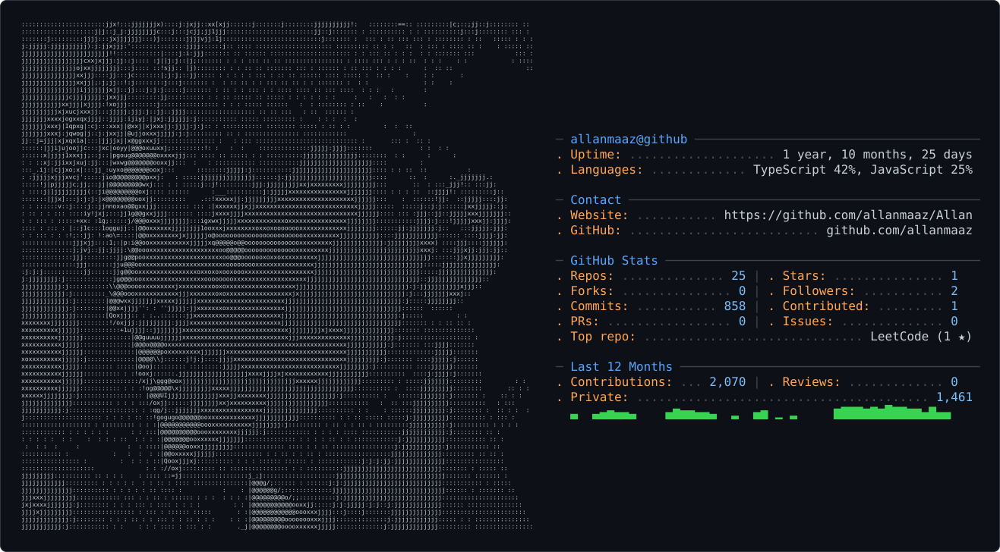

  <picture>
    <source media="(prefers-color-scheme: dark)" srcset="dark_mode.svg">
    <source media="(prefers-color-scheme: light)" srcset="light_mode.svg">
    
  </picture>

<h2 align="center">Hi there, I'm Mohammed Maaz 👋</h2>

  Computer Science Student · Full-Stack Developer (Spring Boot + React) · DSA Enthusiast

  
  
  

---

## 💫 About Me

I’m a **Computer Science student** focused on building real-world, scalable applications.  
Currently sharpening my skills in **Full-Stack Development** with **Spring Boot + React**, while consistently practicing **Data Structures & Algorithms on LeetCode (Java)**.

- 💻 Strong foundation in **Java**, with hands-on experience in **Python** and **C**
- 🛠️ I learn best by **building projects**, breaking things, and engineering them better the next time
- 🌱 Focused on writing clean, efficient, and maintainable code

### 🎯 Current Goals
- Become industry-ready as a **Full-Stack Developer**
- Strengthen problem-solving and system design thinking
- Ship meaningful projects that solve real-world problems

---

## 💻 Tech Stack

**Languages**  

**Frameworks & Libraries**  

**Platforms & Hosting**  

---

## 🧠 Languages I’ve Used So Far

  

---

## 📊 GitHub Stats

  <picture>
    <source media="(prefers-color-scheme: dark)" srcset="https://github-readme-stats.vercel.app/api?username=allanmaaz&theme=dark&hide_border=false&include_all_commits=true&count_private=true">
    <source media="(prefers-color-scheme: light)" srcset="https://github-readme-stats.vercel.app/api?username=allanmaaz&theme=default&hide_border=false&include_all_commits=true&count_private=true">
    
  </picture>
  <picture>
    <source media="(prefers-color-scheme: dark)" srcset="https://github-readme-stats.vercel.app/api/top-langs/?username=allanmaaz&theme=dark&hide_border=false&include_all_commits=true&count_private=true&layout=compact">
    <source media="(prefers-color-scheme: light)" srcset="https://github-readme-stats.vercel.app/api/top-langs/?username=allanmaaz&theme=default&hide_border=false&include_all_commits=true&count_private=true&layout=compact">
    
  </picture>

  <picture>
    <source media="(prefers-color-scheme: dark)" srcset="https://streak-stats.demolab.com/?user=allanmaaz&theme=dark&hide_border=false">
    <source media="(prefers-color-scheme: light)" srcset="https://streak-stats.demolab.com/?user=allanmaaz&theme=default&hide_border=false">
    
  </picture>

### 🏆 GitHub Trophies

  <picture>
    <source media="(prefers-color-scheme: dark)" srcset="https://github-trophies.vercel.app/?username=allanmaaz&theme=radical&no-frame=false&no-bg=false&margin-w=4">
    <source media="(prefers-color-scheme: light)" srcset="https://github-trophies.vercel.app/?username=allanmaaz&theme=flat&no-frame=false&no-bg=false&margin-w=4">
    
  </picture>

### 📈 Contribution Activity

  <picture>
    <source media="(prefers-color-scheme: dark)" srcset="https://github-readme-activity-graph.vercel.app/graph?username=allanmaaz&theme=github-compact">
    <source media="(prefers-color-scheme: light)" srcset="https://github-readme-activity-graph.vercel.app/graph?username=allanmaaz&theme=minimal">
    
  </picture>

